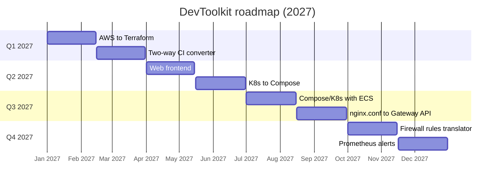

# Roadmap

DevToolkit focuses on converters that are **rare or don't exist yet**. Tools that already exist in many places (Base64, JWT decoders, cron explainers and the like) are deliberately left out.

Features are listed in priority order and tracked on the project's GitHub Projects board. Dates are targets, not promises.

## Timeline

## Planned

| # | Feature | What it does | Why it's needed |
|---|---------|--------------|-----------------|
| 1 | **AWS → Terraform** | CloudFormation (JSON/YAML), AWS SAM and AWS CDK (via `cdk synth` output) → Terraform | Only one CloudFormation converter exists, and none for CDK |
| 2 | **Two-way CI converter** | Any direction between GitHub Actions, GitLab CI, CircleCI, Jenkins (declarative) and Azure Pipelines | Existing tools convert one way only, into GitHub Actions |
| 3 | **Web frontend** | Hosted web app with every converter, served over HTTPS | Lets anyone use DevToolkit without running it |
| 4 | **Kubernetes → Docker Compose** | Deployments, Services, ConfigMaps → Compose services | No maintained tool goes this direction |
| 5 | **Compose / Kubernetes ↔ AWS ECS** | Both directions between Compose, Kubernetes and ECS task definitions | Existing tools are stale or only partly cover Compose |
| 6 | **nginx.conf → Gateway API** | `server`/`location`/`proxy_pass` → `Gateway` + `HTTPRoute` | Existing tools start from Kubernetes Ingress, not raw nginx config |
| 7 | **Firewall rules translator** | Any direction between AWS Security Groups, GCP firewall rules, Azure NSGs and Kubernetes NetworkPolicy | No tool covers GCP or NetworkPolicy |
| 8 | **Prometheus alerts → Datadog / CloudWatch** | Prometheus alerting rules → Datadog monitors and CloudWatch alarms | No converter targets Datadog or CloudWatch |

Every converter follows the same rule as the existing one: anything it can't convert exactly is reported in `notes`, never silently dropped or guessed.

## Not yet scheduled

- Ad-supported public hosting, from the original project vision. Revisit after the web frontend (priority 3) is live.

## Done

- `converter-api` (FastAPI): Docker Compose to Kubernetes, YAML validation
- Raw Kubernetes manifests: probes, resource limits, non-root, restricted Pod Security
- CI: lint, tests with a 95% coverage gate, Docker build, manifest validation, end-to-end deploy on kind
- Image publishing to GitHub Container Registry
- Manual, keyless production deploy workflow
- Dependabot, CodeQL, SHA-pinned actions

## Dropped

- **`utility-api`** (Base64, JWT decode, cron explain, hashing). These tools are already widely available, so building them would add clutter rather than value.

## Out of scope

These are deliberately not planned:

- User accounts and authentication
- Database or persistent storage
- Rate limiting
- Paid features
- Mobile app
