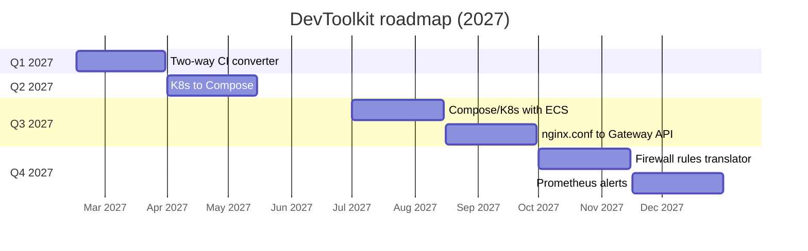

# Roadmap

DevToolkit builds converters that **few other tools offer**. For common tasks such as Base64, JWT decoding or explaining cron expressions, use one of the many tools that already exist.

The features below are in priority order. The [DevToolkit roadmap board](https://github.com/users/zainsohail88/projects/2/views/3) tracks them. The dates are targets.

## Timeline

## Planned

| Feature | What it does | Why it is needed |
|---------|--------------|------------------|
| **Two-way CI converter** | Any direction between GitHub Actions, GitLab CI, CircleCI, Jenkins (declarative) and Azure Pipelines | Existing tools convert one way only, into GitHub Actions |
| **Kubernetes → Docker Compose** | Deployments, Services, ConfigMaps → Compose services | Maintained tools convert only the other way, from Compose to Kubernetes |
| **Compose / Kubernetes ↔ AWS ECS** | Both directions between Compose, Kubernetes and ECS task definitions | Existing tools are out of date or cover only part of Compose |
| **nginx.conf → Gateway API** | `server`/`location`/`proxy_pass` → `Gateway` + `HTTPRoute` | Existing tools start from Kubernetes Ingress |
| **Firewall rules translator** | Any direction between AWS Security Groups, GCP firewall rules, Azure NSGs and Kubernetes NetworkPolicy | Existing tools leave out GCP and NetworkPolicy |
| **Prometheus alerts → Datadog / CloudWatch** | Prometheus alerting rules → Datadog monitors and CloudWatch alarms | Existing converters leave out Datadog and CloudWatch |

Each new converter works like the existing ones. It reports anything it converts only in part in `notes`. It also gets a web page and an API endpoint.

## Later

- Ad-supported public hosting, an idea from the original project plan. We will look at it again once the web UI has been live for a while.

## Done

- `converter-api` (FastAPI): Docker Compose to Kubernetes, YAML validation
- **AWS → Terraform** ([#9](https://github.com/zainsohail88/devtoolkit/issues/9)): CloudFormation (JSON/YAML), AWS SAM and AWS CDK (`cdk synth` output) to Terraform, with hand-written `aws` provider mappings for 85 common types and the `awscc` provider for the rest; CI checks the output with `terraform validate`. See [CloudFormation to Terraform](reference/cloudformation-to-terraform.md)
- `web` (FastAPI + Jinja2 + Tailwind): a page per tool that calls the API from the server. Only `web` can reach the API
- Plain Kubernetes manifests: probes, resource limits, non-root, restricted Pod Security, NetworkPolicy
- CI: lint and house code rules, tests with a 95% coverage gate, Docker builds, manifest validation, Terraform validation, end-to-end on kind including the NetworkPolicy
- Image publishing to GitHub Container Registry, one image per service
- Dependabot, CodeQL, SHA-pinned actions

## Dropped

- **`utility-api`** (Base64, JWT decode, cron explain, hashing). Many tools already do these jobs well, so building them here would only add clutter.

## Out of scope

The project leaves these to other tools:

- User accounts and authentication
- Database or persistent storage
- Rate limiting
- Paid features
- Mobile app
